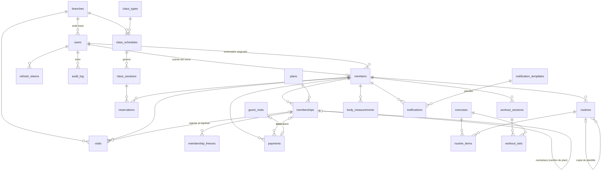

# GymOS · Arquitectura y decisiones

## 1. Propuesta

**Dirección visual: “industrial editorial”.** En un gimnasio la pantalla se lee de lejos, con prisa y a veces con las manos ocupadas. Por eso la interfaz trata los números como titulares (Big Shoulders Display, condensada y pesada), usa IBM Plex Sans con cifras tabulares para los datos y se apoya en una grilla visible, bordes finos y separadores en lugar de tarjetas con sombra. Hay **un solo acento**, verde lima de chaleco reflectante (`#D4FF3A`), y se reserva para la acción principal y para “acceso autorizado”. El rojo y el ámbar solo comunican estado: vencido y por vencer. El modo oscuro es el predeterminado y hay un modo claro opcional.

**Frontend: React 19 + TypeScript + Vite.** Elegí React por su ecosistema maduro para formularios y estados de carga, y porque una sola base de código cubre tres contextos muy distintos: el panel de escritorio, la tablet de recepción y el celular del socio. Vite da arranque instantáneo. No hay librería de componentes ni de gráficos: los gráficos son SVG propios, así respetan la estética y el bundle queda en unos 137 kB comprimidos.

**Backend: Node 24 + Express 5 + Zod 4 + SQLite nativo (`node:sqlite`).**
- Node ejecuta TypeScript directamente, sin paso de compilación.
- SQLite basta para un gimnasio de una a pocas sedes. Además da transacciones `BEGIN IMMEDIATE`, que serializan las escrituras y evitan condiciones de carrera en cupos y pagos.
- Las reglas críticas viven también en la base de datos como triggers: cupos, pagos inmutables y auditoría no editable. Una petición mal formada o un script directo no puede romperlas.
- Cada ruta se declara una sola vez con sus esquemas Zod. De esa declaración salen la validación, el control de roles y la especificación **OpenAPI 3.1** en `/api/openapi.json`, que se navega en `/api/docs`.

```
Navegador ──/api──▶ Express (http.ts: auth JWT · roles · Zod · errores) ──▶ módulos ──▶ dominio puro ──▶ SQLite + triggers
   ▲                                                   │
   └── cookie httpOnly (refresh rotativo) ◀────────────┘        jobs.ts: recordatorios, no-shows, correo saliente (cada 10 min)
```

## 2. Modelo de datos

Hay 8 migraciones versionadas en `server/migrations/`, que se aplican solas al iniciar el servidor; `npm run migrate -w server` las aplica a mano. Los montos se guardan en céntimos (enteros) y las fechas de vigencia como `YYYY-MM-DD` en la hora local del gimnasio. Los instantes (pagos, visitas, clases) se guardan en ISO UTC.



| Migración | Tablas |
|---|---|
| 0001 core | `branches`, `users` (personal y socios con acceso), `refresh_tokens`, `login_attempts`, `settings`, `audit_log` (con triggers que impiden editarlo o borrarlo) |
| 0002 socios | `members`, `plans`, `memberships`, `membership_freezes` |
| 0003 acceso | `visits` (incluye los rechazos), `guest_visits` |
| 0004 clases | `class_types`, `class_schedules` (horario semanal), `class_sessions` (instancias), `reservations` + triggers de cupo |
| 0005 pagos | `payments` (no se borran; solo pasan de válido a anulado), `receipt_counter` |
| 0006 entrenamiento | `exercises`, `routines`, `routine_items`, `workout_sessions`, `workout_sets`, `body_measurements` |
| 0007 avisos | `notification_templates`, `notifications` (in-app, sin duplicados), `email_outbox` |
| 0008 sesiones | `refresh_tokens.rotated_at` (margen para pestañas simultáneas) |

### Integridad garantizada por la base de datos
- **Sin sobreventa ni doble reserva:** un trigger impide confirmar una reserva si la clase ya llegó a su cupo, y un índice único parcial impide que un socio tenga dos reservas vivas en la misma clase.
- **Sin check-in con membresía inválida:** la validación está en `checkIn()` y el rechazo también queda registrado en `visits`.
- **Pagos:** el trigger `payments_no_delete` impide borrar un pago. `payments_immutable` solo permite pasar de `valid` a `voided`, con autor, fecha y motivo. Cada anulación queda en `audit_log` junto con el estado anterior.

## 3. Estructura de carpetas

```
GIN/
├─ package.json            workspaces + scripts (dev, test, seed, build)
├─ scripts/                setup.mjs (.env con secretos), dev.mjs (API + web), endpoints.ts
├─ docs/                   este documento y endpoints.md
├─ server/
│  ├─ migrations/          0001…0008 *.sql
│  ├─ src/
│  │  ├─ index.ts · app.ts · config.ts · jobs.ts
│  │  ├─ db/               conexión, transacciones, migrador
│  │  ├─ lib/              http (rutas+OpenAPI), crypto, fechas, reloj, errores, pdf, ajustes, auditoría
│  │  ├─ domain/           reglas puras y probadas: membership.ts (estados, prorrateo, congelamiento), classes.ts (cupos, espera, cancelación)
│  │  ├─ modules/          auth, members, memberships, checkin, classes, payments, training, reports, notifications, admin, access-control
│  │  └─ seed/seed.ts      datos de demostración
│  └─ test/                unit/ (reglas de negocio) · integration/ (HTTP: check-in, pagos, reservas, seguridad)
└─ web/
   └─ src/
      ├─ lib/              api (token en memoria + renovación), auth, hooks, formatos, tipos
      ├─ components/       ui, Shell (riel lateral / barra inferior), charts (SVG), Progress, MembershipActions
      └─ pages/            member/ · staff/ · admin/
```

La lista completa de endpoints está en [endpoints.md](endpoints.md).

## 4. Roles y permisos

| | Socio | Recepción | Entrenador | Admin |
|---|---|---|---|---|
| Plan, pase QR, reservas, pagos propios | ✔ | | | |
| Check-in (QR / DNI), invitados | | ✔ | | ✔ |
| Alta de socios, venta, renovación, congelamiento, cambio de plan | | ✔ | | ✔ |
| Registrar y anular pagos | | ✔ (anula solo los suyos del día) | | ✔ |
| DNI completo | el suyo | ✔ | ✘ (enmascarado) | ✔ |
| Notas de salud | las suyas | ✘ | solo de sus socios asignados | ✔ |
| Rutinas, progreso y medidas | los suyos | ✘ | solo de sus socios asignados | ✔ |
| Pagos y deuda de un socio | los suyos | ✔ | ✘ | ✔ |
| Reportes, configuración, personal, auditoría | | mapa de calor y retención | | ✔ |

Cada consulta a DNI, fecha de nacimiento o salud por alguien distinto del propio socio genera un registro `pii.view` en la auditoría: quién, qué campos y cuándo.

## 5. Seguridad
- **Contraseñas:** scrypt (N=2¹⁷) con sal propia. Si el correo no existe, se compara igual contra un hash ficticio para que el tiempo de respuesta no revele qué cuentas existen.
- **Tokens:** el access token JWT dura 15 min y vive solo en memoria del navegador. El refresh token dura 7 días, va en cookie `httpOnly; SameSite=Strict` y **cambia en cada uso**.
  - Si alguien reutiliza un token viejo pasados 30 s desde su rotación, se asume robo y se revoca toda la cadena de sesiones.
  - El margen de 30 s existe para que dos pestañas que renuevan a la vez no cierren la sesión.
  - Las rutas de sesión exigen además el encabezado `X-Requested-With: gymos` como defensa CSRF.
- **Fuerza bruta:** bloqueo tras 5 intentos fallidos por cuenta o 20 por IP en 15 min, con respuesta 429 que indica cuánto esperar. Hay además un límite global por IP.
- **QR de ingreso:** formato `G1.<socio>.<expira>.<HMAC>`, que caduca a los 60 s (configurable) y rota solo en el celular. Una captura de pantalla compartida no sirve.
- **Encabezados:** `nosniff`, `X-Frame-Options: DENY` y `no-store` en la API.

## 6. Decisiones de negocio (configurables en Admin › Ajustes)

| Decisión | Valor por defecto | Dónde se cambia |
|---|---|---|
| Moneda / formato / zona horaria | PEN · es-PE · America/Lima | Ajustes |
| Aviso “por vencer” | 7 días antes | Ajustes |
| Recordatorios de vencimiento | 7, 3 y 0 días antes (in-app + correo) | Ajustes |
| Cancelación de reservas por el socio | hasta 2 h antes; después solo recepción, y queda marcada como tardía | Ajustes |
| Ventana de reserva | 7 días | Ajustes |
| Ingreso con deuda | permitido con aviso visible | Ajustes |
| Doble escaneo | no cuenta como otra visita dentro de 10 min | Ajustes |
| Congelamiento | mínimo 7 días; máximo por plan (p. ej., trimestral 15 d); los días se suman al vencimiento | Ajustes / Planes |
| Gracia para contar una baja | 15 días tras vencer | Ajustes |
| Pase diario de invitado | S/ 25 | Ajustes |
| Vigencia del QR | 60 s | Ajustes |
| Anulación de pagos | recepción: solo pagos propios del mismo día; admin: cualquiera | Código (`voidPayment`) |
| Cambio de precio de un plan | solo afecta ventas futuras | Planes |

**Membresía vencida el mismo día.** El plan cubre hasta el final de su `end_date`, en la hora local del gimnasio. Ese día el socio entra con el aviso “Hoy es el último día”, y al día siguiente se le niega el acceso.

**Prorrateo al cambiar de plan.**
1. Se calcula el valor consumido del plan actual (días usados ÷ días totales × precio de lista).
2. Lo pagado de más se vuelve crédito, que se descuenta del plan nuevo.
3. El nuevo periodo empieza hoy.
4. Si el crédito supera el precio del plan nuevo, el sobrante se informa para gestionar la devolución; no se aplica solo.

**Renovar en un clic.** Vende el mismo plan empezando el día siguiente al vencimiento vigente, sin huecos ni solapes. Si el plan ya venció, empieza hoy.

**Lista de espera.**
- Funciona en orden de llegada (FIFO).
- Cuando se libera un cupo, ya sea por una cancelación o porque se amplió el cupo, se promueve automáticamente al primero que siga teniendo un plan válido para esa fecha. Quien ya no lo tenga se salta.
- El promovido recibe un aviso in-app y por correo.
- Una reserva confirmada que no se usa se marca como “no vino” una hora después de terminada la clase.
